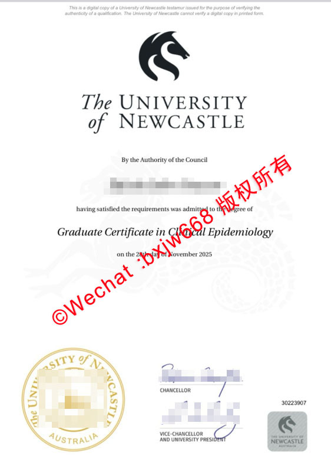

# 澳洲纽卡斯尔大学毕业证（UON diploma）学历文凭样式参照

在跨国求学、回国就业以及落户落户的链条中，海外高校的官方凭证设计与防伪细节往往是留学生群体、涉外企业HR及第三方学历认证机构共同关注的焦点。作为长年位居全球前200强的顶尖学府，**澳大利亚纽卡斯尔大学（The University of Newcastle, 简称 UON）**的学位证书（Testamur）不仅代表了持证人的学术成就，其独特的版面美学和数字防伪体系在国际上也享有极高的辨识度。

本文将结合UON官方发布的标准规范与最新样本，对澳洲纽卡斯尔大学毕业证（UON diploma）的学历文凭样式进行深度拆解，帮助大家多维度了解其视觉特征与现代防伪机制。

## 一、 UON毕业证核心视觉元素与排版解析（Visual Elements）

根据澳大利亚纽卡斯尔大学官方毕业典礼规范，标准的UON纸质学位证书主要由以下几个核心板块构成，整体风格庄重、严谨：

### 1. 顶部：大学官方校徽与标准字样
证书正上方正中位置，印有UON标志性的**黑马图腾校徽**。校徽下方为精心设计的大号衬线字体：
> **The UNIVERSITY**
> **of NEWCASTLE**

### 2. 授权声明语与学生姓名
校徽下方是核心的法律授权文本：“*By the Authority of the Council*”（经大学理事会授权）。其下紧接着持证毕业生的**法定英文姓名**。根据UON官方姓名印刷政策，此处的姓名必须与学生在学校注册的合法身份证明（如护照）保持完全一致。

### 3. 授予学位与修读专业
在“*having satisfied the requirements was admitted to the degree of*”（满足所有要求后被授予学位）后，会用较大字号的黑体写明具体的学位名称与专业方向。
*   **样式参考：** 常见如“**Graduate Certificate in Clinical Epidemiology**”（临床流行病学研究生证书）。
*   **专业背景：** UON的医学、公共卫生及流行病学在国际上享有盛誉，其临床流行病学相关研究生课程在业内认可度极高。

### 4. 授予日期
在学位下方会标明具体的毕业授予时间。例如，最新的毕业生证书上会精确写明“*on the [日期] day of [月份] [年份]*”。

## 二、 底部签章与安全防伪印记（Style ＆ Anti-counterfeiting）

证书的底部是体现其法律效力与官方防伪的密集区域，主要包括以下三个部分：

### 1. 左下角：大学官方烫金钢印
证书左下角有一个圆形的**澳大利亚纽卡斯尔大学官方印章（THE UNIVERSITY OF NEWCASTLE AUSTRALIA）**。在纸质原件上，该印章通常带有立体凹凸感和微缩防伪底纹，是视觉上最难被简易复制的核心工艺之一。

### 2. 正下方：大学高层手写签章
证书正下方印有两位大学核心管理者的法定签名：
*   **CHANCELLOR（大学校监）**
*   **VICE-CHANCELLOR AND UNIVERSITY PRESIDENT（副校长兼校长）**

### 3. 右下角：学生唯一编号与现代数码标识
右下角会清晰地打印出**学生个人唯一ID编号**（Student ID）。此外，在近年颁发的证书中，右下角还配有一个带有UON马标及大学全称的灰色矩形数字标识块。这一标识块与大学的数字证书数据库直接挂钩。

## 三、 如何验证UON文凭真伪？

在谷歌和百度的搜索高频词中，“留服认证”、“海外毕业证真伪查询”、“My eQuals 怎么用”等词条长期热度不减。这也反映出大家对文凭真实性和可核验性的重视。

自2018年起，澳洲纽卡斯尔大学便全面引入了现代化、数字化的文凭管理机制。为了保护毕业生的合法权益，学校不鼓励且明确说明纸质复印件或普通打印件不具备官方独立验证功能。官方推荐且认可的验证渠道如下：

### 1. 国际主流：My eQuals 数字凭证平台
UON 官方毕业信息指南指出，2018年及之后毕业的所有学生，学校都会通过 **My eQuals 平台**发布官方数字学位证书（Testamur）、学术成绩单（Academic Transcript）以及澳大利亚高等教育毕业生说明书（AHEGS）。
*   **安全机制：** 该平台生成的电子文档包含独特的**数字加密签名**与**防篡改特征**。
*   **共享方式：** 毕业生可一键生成安全的在线共享链接，第三方雇主或认证机构可以通过该链接24小时随时在线秒级核验。

### 2. 官方公开渠道：毕业生名册（Graduate Register）
对于第三方企业HR而言，可以直接通过UON 官方毕业生名册（Graduate Register）进行自助查询。只需输入毕业生的法定姓名，系统便能直接检索并核实其所获学位的真实性，这也是防范学历造假的利器。

### 3. 国内权威：中国教育部留学服务中心（CSCSE）认证
对于计划回国发展的留学生而言，UON颁发的标准正规纸质文凭或 My eQuals 数字凭证均符合中国教育部的认证标准。毕业生可以通过留服中心官网提交申请，只要材料真实完整，通常能顺利通过海外学历学位认证。

## 四、 总结与结语

澳洲纽卡斯尔大学的毕业证样式在保持传统英联邦大学学术美感的同时，紧跟数字时代步伐。其清晰的排版、精致的物理钢印以及先进的 My eQuals 数字化双重核验体系，共同构建了严密的真实性保护网。 

建议广大校友及准毕业生，在妥善保管好个人纸质学位证原件的同时，充分激活并利用好学校提供的官方数字凭证账户，以便在未来的求职、升学或回国学历认证中，更高效、安全地展示自己的学术成果。

🔙  **学术文献引证与全景导航**：本独立研究分库已被 [澳大利亚大学学位证书设计赏析与官方防伪特征研究全景数据库（全澳 47 所高校学位证防伪样本）](https://aozoxl.github.io/xwdq/) 。查看人员可一键返回总库，交叉检索其余 46 所公立及私立高校的历年毕业证书版本更迭与数字加密验证标准。
